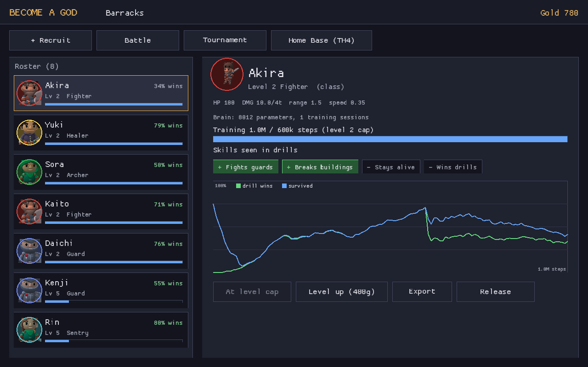
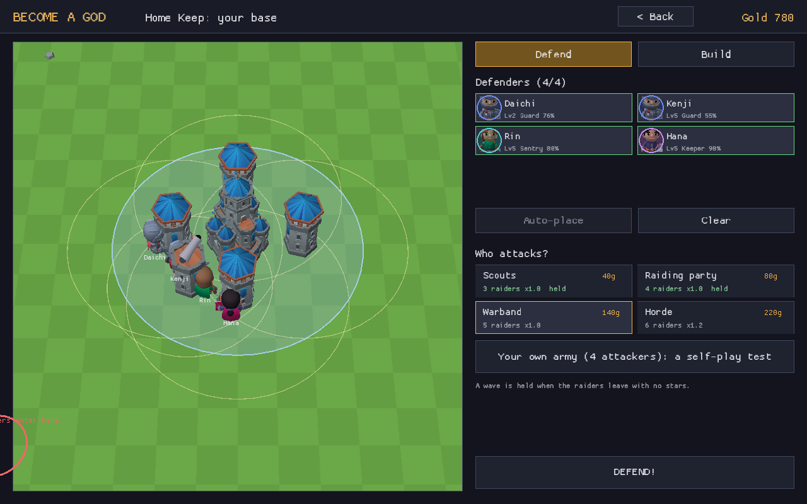
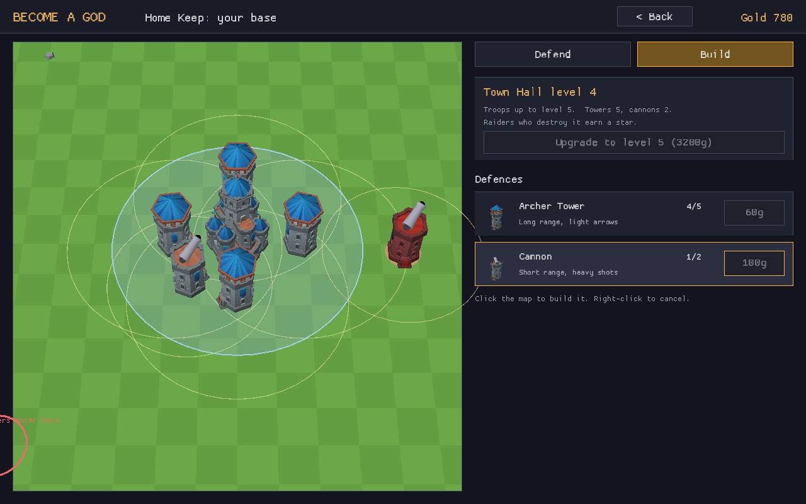
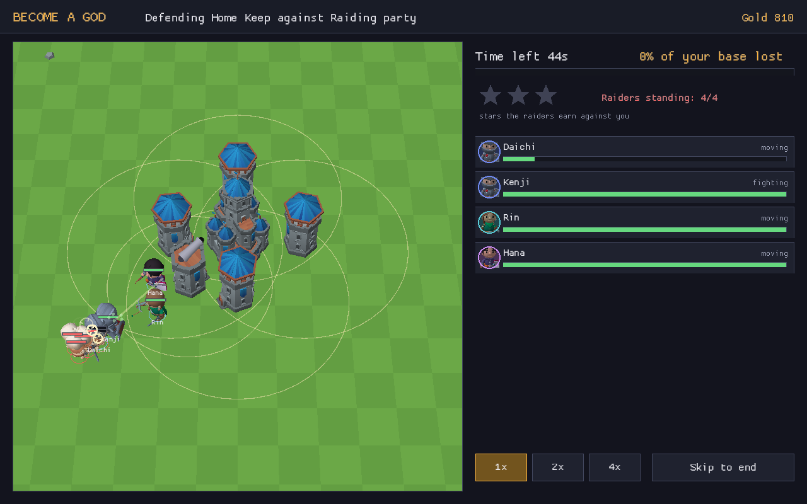
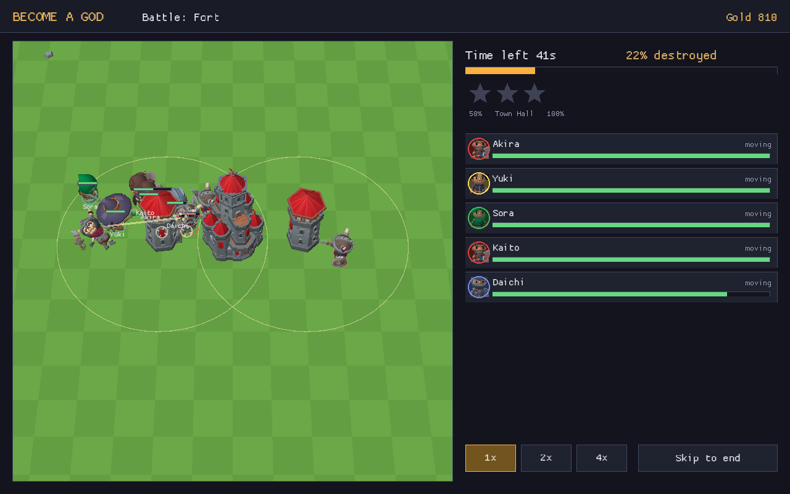
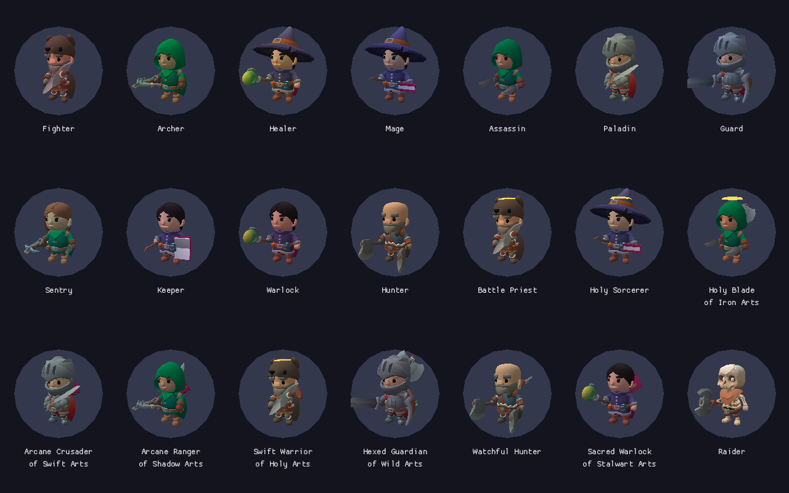

# Become a God

A desktop strategy game where every troop is a tiny reinforcement-learning agent that **you train on your own CPU**. You recruit a troop, give it a training budget, watch it learn in live drills, then send squads against AI-built bases. Defence is RL too: you train defenders, build towers and cannons around your Town Hall, and they hold your base against raid waves or against your own trained army. Everything is Rust and nothing needs a GPU or Python.



For a plain-language explanation of how the troops learn, see [docs/HOW_THE_RL_WORKS.md](docs/HOW_THE_RL_WORKS.md).

## Run it

You need a Rust toolchain (https://rustup.rs). Then:

```
cargo run --release -p become-a-god
```

- **Windows, macOS:** nothing else needed.
- **Linux:** install the window/GL/audio headers first, e.g. `sudo apt install libx11-dev libxi-dev libgl1-mesa-dev libasound2-dev`.

Save data lives in your user data folder (`~/.local/share/become-a-god`, `~/Library/Application Support/become-a-god`, `%APPDATA%\become-a-god`). Set `BAG_SAVE_DIR` to put it elsewhere.

## How to play

1. **Recruit** (50 gold) and make your own troop. Attackers: Fighter, Archer, Healer, Mage (splash spells), Assassin (fast, deadly, fragile), Paladin (armoured tank with a small heal). Defenders: Guard, Sentry, Keeper, Warlock (splash curses), Hunter (fast chaser). Type a percentage for any number of classes of one side, as long as they add up to 100: Mage 50 + Healer 30 + Fighter 20 is a "Holy Sorcerer of Iron Arts" with blended stats, rewards and drills, splash and a heal. The biggest share sets the body and main weapon, the next two show as gear on the back (a healer part adds a halo), and the colour is the mix of all of them. Then set a **training plan**, also in percentages: how many drills are solo raids versus squad raids, how many are against your own trained troops, and what the reward cares about (breaking buildings, fighting troops, healing, staying alive). The same class mix trained with two different plans plays very differently (see below). The plan can be changed before any later training session from the training screen.
2. **Train.** Choose a budget (+50k, +100k, +200k steps or max). Training runs in the background while a live drill shows the newest brain playing. The chart shows wins, survival and timeouts over the last 300 drills, and skill badges light up as sub-skills appear ("Fights guards", "Breaks buildings", "Heals allies", "Stays alive", "Wins drills"). You can stop at any time and keep the progress.
3. **Level up** with gold to raise the training cap: 300k, 600k, 1.2M, 2M, 3.5M steps. Longer training makes a better troop, with diminishing returns. A troop's level can be at most your Town Hall level + 1.
4. **Battle.** Pick a base and up to 5 troops, click the map to place each one outside the red zone (where and how spread out is your call), then FIGHT. Stars work like Clash: 50% destruction, Town Hall destroyed, 100%. New stars pay gold.
5. **Tournament.** Your troops all run the same 12 seeded solo raids and 12 squad raids and get ranked. Any round can be replayed.
6. **Home Base.** Your Town Hall sits in the middle. In the **Build** tab you upgrade it (5 levels; each one adds tower and cannon slots, toughens the hall and raises the troop level cap) and buy and place Archer Towers (long range, light) and Cannons (short range, heavy, from Town Hall 2). Click a building to move it. In the **Defend** tab you place up to 4 trained defenders and pick who attacks: one of four raid waves (Scouts, Raiding party, Warband, Horde) or **your own army** of up to 5 trained attackers, a self-play test of both sides. A wave counts as held when the raiders leave with no stars; the first hold pays the wave's gold.
7. **Export** writes a troop's file (about 250 KB, brain included) to the `exports` folder: that file is what gets shared for wars later.

| Base | Defences | Notes |
|---|---|---|
| Outpost | Town Hall, 1 tower, 3 guards | a trained fighter can 3-star it alone |
| Fort | Town Hall, 2 towers, 5 guards | needs a squad |
| Twin Gate | Town Hall, 3 towers at 1.5x, 6 guards | a mixed squad of 5 |
| Citadel | Town Hall, 4 towers at 2.5x, 8 guards | well-trained squads reach 2 stars at 600k steps; 3 needs more |





## What's in the box

```
crates/godcore   game logic, no graphics
  sim.rs         deterministic battle simulation (the only game rules)
  classes.rs     classes, reward weights, blends of any number of classes, training plans
  scenario.rs    training drills, the four bases, defence drills, home base and raid waves
  env.rs         attack and defence drills as RL environments, reward, shaping, self-play pool
  nn.rs          64x64 tanh MLP with hand-written backprop and Adam
  ppo.rs         PPO with action masking, parallel rollouts (rayon)
  troop.rs       saved troop: class, level, brain, learning curve, skills
  battle.rs      battles, tournaments, replay fingerprint
  bin/godctl.rs  headless CLI: train, eval, battle, cup, defend, baseline
crates/app       macroquad desktop app (barracks, recruit, training, battle, tournament, home base)
  art.rs         characters and buildings drawn in code (no image files)
```

### Simulation
- 32x32 arena. Troops see a 90-number view (self, 2 nearest buildings, 3 nearest enemies, 2 nearest allies, most injured ally, base summary, move cooldowns, crowd size, enemy stun/block, weapon, which class moves it has, cloak/ward state, the 2 nearest allies' role, danger and current action, whether the second nearest can be healed, and talent reach) and choose from 21 actions (idle, 8 moves, hit unit, hit building, heal nearest ally, heal second nearest ally, dodge, block, weapon skill, charge, cloak, blink, snare, ward). Illegal actions are masked, including class moves the troop's classes don't bring.
- Team training (`team.rs`, Team training screen in the barracks, `godctl team` / `godctl teameval`): 2 to 5 of the player's troops of one side train together, each with its own brain; reward is 50% own and 50% team average. See docs/HOW_THE_RL_WORKS.md section 10.
- Class moves (`moves.rs`): each class has its own kit of 1 or 2 moves, and a mix gets every move of each class it has at least 20% of. Moves start at 40% strength and reach full strength after 300k steps of practice, and training is shared evenly across a troop's moves, so a specialist masters its kit far sooner than a mix (jack of all trades, master of none). See docs/HOW_THE_RL_WORKS.md section 9.
- Weapons (Armoury in the barracks): 7 weapons, each with its own stats and skill (Shield Bash, Whirlwind, Ground Slam, Shadowstep, Volley, Fireball, Healing Nova). Mastery (Novice to Grandmaster) grows with training steps holding that weapon. Players pick the brain size (64, 96, 128, 160, 192 or 256 neurons per layer) at recruit and can grow it later in the barracks; it never shrinks. Troops from before the choice grow with level (64 at levels 1-2, then 96, 128, 160). `godctl train --brain N` picks a size from the CLI. Old saves are upgraded on load. Talents that reach several units at once (Healing Nova, Ward, Mage and Warlock splash, Whirlwind, Ground Slam, Volley, Fireball) reach 1 unit at level 1, 2 at levels 2-3, 3 at level 4 and 4 at level 5 (`talents_for_level`). `SIM_VERSION` is 5.
- Buildings are solid now (the prototype let the fighter stand on the tower).
- **Deterministic everywhere.** Units update in index order, only `+ - * / sqrt` are used, random directions come from rejection sampling instead of trig, and the network uses a hand-written `exp`/`tanh` so it does not depend on the platform's math library. Battles pick the highest-scoring legal action, which needs no `exp` at all. The battle screen re-simulates every finished battle and shows "Replay check: identical". `cargo test` includes a pinned fingerprint of a full Twin Gate battle, so a platform that diverges fails the test.

### Training
- PPO, gamma 0.995, 16 envs x 512 steps per update, 10 epochs, 15k parameters (actor 8k + critic 7k). About **6,000 to 10,000 steps/s on a 4-core CPU** (the Python prototype did 5,500), so 300k steps take 30 to 50 seconds.
- Fixes from the prototype findings:
  - **Running out of time costs more than dying** (-1.5 vs -1), which removes the "hide until timeout" exploit.
  - **Building damage is weighted 2x** and there is a **potential-based approach bonus** (a shaping term that does not change the best strategy). Before these, a fighter at 400k steps won 0% of greedy drills on some seeds. After, 60 to 77% on every seed tried.
- Healers get a "stay near allies" shaping term and a penalty when an ally dies.

### Defence training
- Defenders train in their own drills: 3 copies of the troop near a Town Hall with 1 or 2 towers, against a raid of 2 or 3 fighters coming from a random side and distance. Ranged and healing defenders also get 2 built-in frontline guards, so a Sentry or Keeper learns its support job instead of having to tank.
- Reward: losing base HP costs 2x, damage to raiders pays, holding the base pays +1 and losing it costs 1, dying costs 0.5. A shaping term pulls defenders back to their post near their own buildings; without it guards charged out of tower cover and lost.
- **Self-play.** When you have trained troops of the other side, half of all drills use them: an attacker trains against your trained defenders, a defender trains against your trained attackers. The training screen says when this is on. From the CLI: `--vs a.json,b.json`.

| Defender (600k steps) | Defence drills held | Untrained |
|---|---|---|
| Guard | 67% | 3% |
| Sentry | 88% | 28% |
| Keeper | 94% | 31% |

Home base against waves, with 2 Guards, a Sentry and a Keeper (600k steps each) placed by auto-place. "Held" = raiders got no stars.

| Town Hall | Scouts (3) | Raiding party (4) | Warband (5) | Horde (6, 1.2x) |
|---|---|---|---|---|
| 1 (2 towers) | held, 0% lost | fallen | fallen | fallen |
| 3 (4 towers) | held, 0% lost | 2 stars | 2 stars | fallen |
| 5 (6 towers, 2 cannons) | held, 0% lost | held, 18% lost | 1 star | fallen |

Untrained defenders lose every wave at Town Hall 1, and at every Town Hall they lose more of the base than trained ones. The Horde needs better-trained defenders.

### Art
The world is 3D, seen from an angled camera over the base like Clash of Clans (mouse wheel zooms). Characters and buildings are free CC0 models from KayKit by Kay Lousberg (see [CREDITS.md](CREDITS.md)), loaded from the `assets` folder and animated on the CPU, so it still runs on any machine with basic OpenGL.

| Class | Model and gear |
|---|---|
| Fighter | Barbarian with a two-handed axe |
| Archer | Hooded rogue with a heavy crossbow |
| Healer | Mage with a staff |
| Guard | Knight with sword and shield |
| Sentry | Rogue with a hand crossbow and knife |
| Keeper | Mage with a spellbook and wand |
| Mage | Mage with wand and spellbook, blue robes |
| Assassin | Hooded rogue with two daggers |
| Paladin | Knight with a greatsword |
| Warlock | Mage with a staff, crimson robes |
| Hunter | Barbarian with two axes |
| Raiders, AI base guards | Skeletons |

Each class has its own walk, attack and death animations. A blend carries its second and third classes on its back (axe, quiver, shield, crossbow, spellbook, tome, dagger, greatsword, staff or greataxe), and a healer part adds a golden halo. Splash spells fly as glowing orbs and burst on impact. Towers and castles are blue for your side and red for enemies, collapse into rubble when destroyed, and arrows and cannonballs fly in arcs. The cannon barrel and the halo are built in code. If the `assets` folder is missing the game falls back to the older 2D drawings in `art.rs`. Set `BAG_ASSETS` to load assets from another folder.





### Results (600k steps, 200 unseen drills each, greedy play)

| Troop | Solo raid wins | Squad raid wins | Notes |
|---|---|---|---|
| Untrained (any class) | 0% | ~1% | |
| Scripted "guards first" fighter | 56% | 80% | |
| Fighter | 75% | 63% | clears guards, then towers before the core |
| Archer | 54% | 62% | never dies solo: learned to fire from outside guard and tower reach |
| Healer | 0% (can't) | 70% | heals ~210 HP per drill and turns a losing squad into a winning one |
| Battle Priest (fighter+healer) | 0% | 44% | kills guards, heals, weak on buildings |
| Spirit Ranger (archer+healer) | 0% | 60% | heals ~100 HP per drill |

## Videos

Recordings of the real app are in `videos/`: making a custom troop (Mage 50, Healer 30, Fighter 20, with typed percentages and a training plan), training it and changing its plan, an attack on the Fort, defending the Home Keep against a raid wave and against your own army, a tournament with replays, and upgrading the Town Hall and placing buildings. `all_modes.mp4` is all five in a row.

They are made with a built-in recorder: `BAG_RECORD=out.mp4 BAG_TOUR=tour.txt` runs the game on a fixed 30 fps clock, moves and clicks the mouse from the tour script and pipes each frame to ffmpeg, so the video plays at real speed on any machine. The tours are in `tools/tours/` and `tools/record.sh` runs one. The clips were recorded with a save holding 8 trained troops at Town Hall 4; the build clip starts from Town Hall 2.

### Custom mixes and training plans (400k steps, 200 unseen drills each)

| Troop | Solo raid wins | Squad raid wins | Notes |
|---|---|---|---|
| Fighter (for comparison) | 76% | 67% | |
| Mage | 48% | 40% | splash clears guard clumps |
| Assassin | 30% | 59% | kills nearly every guard, fragile against towers |
| Paladin | 32% | 94% | the squad's tank: keeps everyone alive |
| Warlock (defence) | 95% held | | base lost 12% |
| Hunter (defence) | 60% held | | |
| Guard 40 + Warlock 35 + Hunter 25 (defence) | 65% held (training) | | |
| Mage 50 + Healer 30 + Fighter 20, class default plan | 0% | 27% | |
| same mix, plan: 80% solo, focus 60% buildings | 0% | 45% | ignores guards (4% of them) and rushes buildings |
| same mix, plan: 20% solo, focus 45% healing | 0% (survives 94%) | 49% | heals 56 HP per squad drill and stays out of fire |

## Command line

```
cargo run --release -p godcore --bin godctl -- train --class fighter --steps 300000 --out f.troop.json
cargo run --release -p godcore --bin godctl -- train --class fighter+healer:0.5 --steps 300000 --out p.troop.json
cargo run --release -p godcore --bin godctl -- train --class mage:50,healer:30,fighter:20 --solo 80 --focus 60,20,5,15 --selfplay 30 --steps 400000 --out m.troop.json
cargo run --release -p godcore --bin godctl -- eval f.troop.json
cargo run --release -p godcore --bin godctl -- battle --base 1 f.troop.json f.troop.json p.troop.json
cargo run --release -p godcore --bin godctl -- cup f.troop.json p.troop.json
cargo run --release -p godcore --bin godctl -- train --class guard --steps 600000 --out g.troop.json
cargo run --release -p godcore --bin godctl -- train --class fighter --steps 300000 --vs g.troop.json --out f2.troop.json
cargo run --release -p godcore --bin godctl -- defend g.troop.json g.troop.json s.troop.json k.troop.json --wave 1 --th 3
cargo run --release -p godcore --bin godctl -- defend g.troop.json s.troop.json --army f.troop.json,f2.troop.json
cargo test --release
```

## Not done yet
- Wars against other players: the pieces are in place (deterministic sim, small shareable troop files, replay check, self-play) but there is no import screen, matchmaking or networking yet.
- Walls, traps and more building types. Raiding the AI bases still uses the four preset layouts; only your home base is player-built.
- Sound.
- Model size is fixed at 64x64 for every level; the level only raises the training cap.
- Blends with a heal part are weak at breaking buildings solo, and the new attack classes need longer training than the Fighter to win solo raids.
- Balance is tuned against troops trained to 600k steps and will need more passes.
