# Become a God: trailer storyboard

The picture plan for the 90-second trailer in [SCRIPT.md](SCRIPT.md). 18 shots in 5 acts. Each panel uses the closest real screenshot from the game as its reference frame; the **Capture** line says how to film it for real.

**Format:** game captured at 1280x800 with the built-in recorder (`BAG_RECORD`, `BAG_TOUR`, see [tools/record.sh](../../tools/record.sh)), then scaled into a 1920x1080 frame. The game UI is shown as it is; the only additions in the edit are punch-in zooms, supers and the title card.

**Camera language:** the game has one fixed angled camera, so all "camera moves" are done in the edit as slow digital pushes and punch-ins on the 1280x800 capture. Keep pushes slow (about 10% scale over a shot). Use hard cuts on beats; no dissolves except the first fade-in and last fade-out.

**Colour:** stay with the game's own palette. Near-black UI (#16161e), gold title text, green field. Supers use the game's pixel font in white, the title card in gold.

## Shot overview

| # | Time | Act | Shot | Source |
|---|---|---|---|---|
| 1 | 0:00 | I | Untrained troop wanders | new capture (fresh recruit) |
| 2 | 0:05 | I | Swings at air, gets shot | new capture |
| 3 | 0:09 | I | Falls. "Drill #1" | new capture |
| 4 | 0:12 | I | Super: NOBODY PROGRAMMED THESE SOLDIERS. THEY LEARNED. | title card |
| 5 | 0:16 | II | Typing class percentages | `recruit.png` / training tour |
| 6 | 0:22 | II | Name resolves: Holy Sorcerer of Iron Arts | `recruit.png` |
| 7 | 0:27 | II | Training plan sliders | `recruit.png`, `plan.png` |
| 8 | 0:32 | II | Click "Recruit (50g) and train" | `recruit.png` |
| 9 | 0:34 | III | Live drill + steps counter | `train.png` |
| 10 | 0:40 | III | Flat chart, troop hides | `train.png` + prototype curve |
| 11 | 0:47 | III | Chart jumps | prototype curve / new capture |
| 12 | 0:51 | III | Skill badges light up | `train.png`, `barracks.png` |
| 13 | 0:56 | IV | Choose base and squad, deploy | `setup.png`, attack tour |
| 14 | 1:00 | IV | FIGHT!: squad hits the Fort | `battle.png` |
| 15 | 1:07 | IV | Castle falls, stars fill | attack tour |
| 16 | 1:11 | IV | Home Keep holds | `defend.png`, defence tour |
| 17 | 1:16 | IV | Champion: Sora | `tournament.png` |
| 18 | 1:20 | V | Gallery push, then title card | `gallery.png` |

---

## ACT I: THE CLAY

### Shot 1 · 0:00 to 0:05 · "First day"

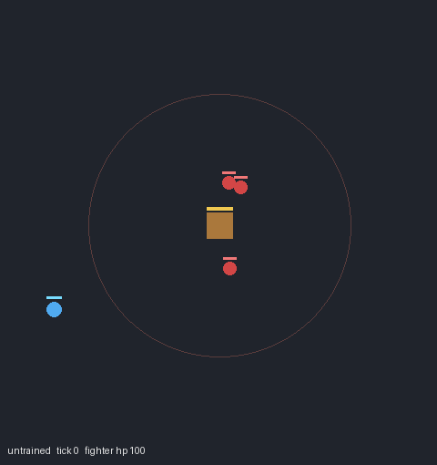

*Reference: the prototype's untrained replay. Re-shoot in the real game.*

- **Frame:** Live drill only, cropped to the arena (no side panel). Fade in from black over 1s.
- **Action:** A brand-new Fighter, 0 steps trained, turns back and forth, idles, walks into the red tower's ring.
- **Camera:** Slow push toward the troop, ending with it centred.
- **VO:** "This is a soldier on its first day."
- **Sound:** Room tone, footsteps.
- **Capture:** Recruit a plain Fighter in a fresh save (`BAG_SAVE_DIR` to an empty folder), press +50k and record the very first live drills. Pick a take where it wanders into tower range.

### Shot 2 · 0:05 to 0:09 · "What is an axe?"

- **Frame:** Punch-in, about 2x, on the troop.
- **Action:** It swings its axe at nothing. An arrow from the tower hits it; its health bar drops.
- **VO:** "It doesn't know what an axe is for. It doesn't know what a tower is."
- **Sound:** One axe whoosh. One arrow thunk.
- **Capture:** Same take as shot 1, cut on the swing.

### Shot 3 · 0:09 to 0:12 · "Nobody will tell it"

- **Frame:** Back out to the arena crop. Add a small super in the top-left corner in the game font: **Drill #1**.
- **Action:** The troop falls. Hold 1 second on the empty field.
- **VO:** "Nobody is going to tell it."
- **Sound:** A soft fall, then silence.
- **Cut:** Smash to black on the silence.

### Shot 4 · 0:12 to 0:16 · Title super

```
+------------------------------------------------+
|                                                |
|                                                |
|       NOBODY PROGRAMMED THESE SOLDIERS.        |
|                                                |
|                 THEY LEARNED.                  |
|                                                |
|                                                |
+------------------------------------------------+
```

- **Frame:** White text on black, game pixel font. Line 1 cuts in, line 2 fades in 1.5s later.
- **Sound:** None, then the first low piano note lands on "THEY LEARNED".

---

## ACT II: THE BREATH OF LIFE

### Shot 5 · 0:16 to 0:22 · Mixing the clay

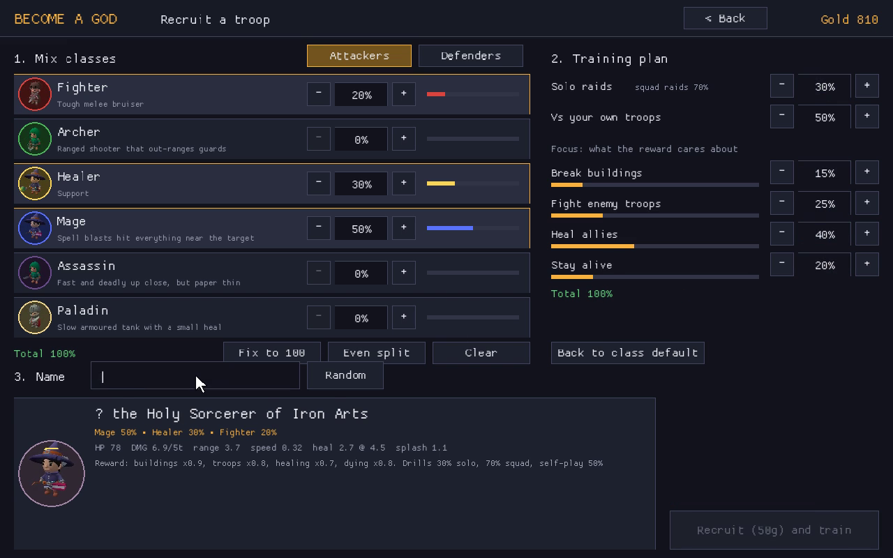

- **Frame:** Punch-in on the left column "1. Mix classes", Fighter to Mage rows.
- **Action:** The cursor clicks +; Mage climbs to 50%, Healer to 30%, Fighter to 20%. Each row's coloured bar grows. "Total 100%" turns green.
- **VO:** "So you start where every god starts. With the clay."
- **Sound:** A UI click per step, a warm chime when the total turns green.
- **Capture:** `tools/tours/training.txt` already types this exact mix. Use its first ~10 seconds.

### Shot 6 · 0:22 to 0:27 · A body

- **Frame:** Punch-in on the preview card at the bottom (portrait + "the Holy Sorcerer of Iron Arts").
- **Action:** The name and stats settle. Hold on the portrait: wizard hat, staff, axe on its back.
- **VO:** "A body."
- **Camera:** Slow push to the portrait.

### Shot 7 · 0:27 to 0:32 · A reason to live

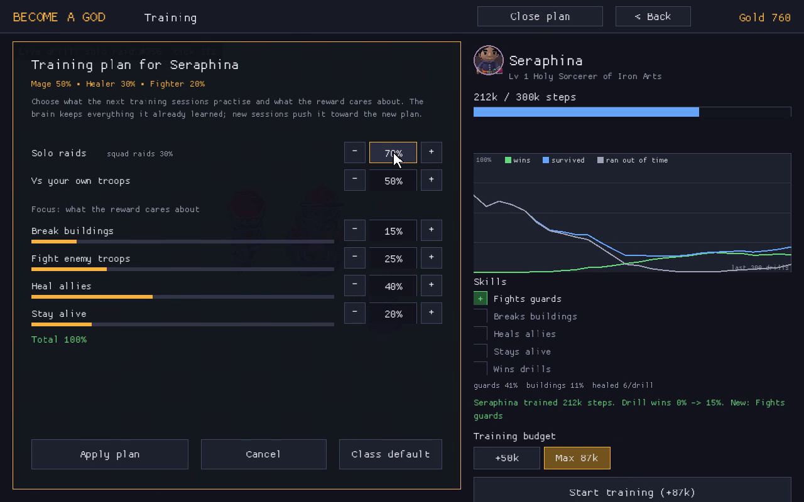

- **Frame:** Punch-in on "2. Training plan".
- **Action:** Heal allies goes up to 40%, Stay alive 20%. The orange bars grow.
- **VO:** "And a reason to live."

### Shot 8 · 0:32 to 0:34 · Recruit

- **Frame:** Bottom-right button, tight.
- **Action:** Click **Recruit (50g) and train**. Gold in the top-right drops by 50.
- **Sound:** A coin sound, then the music pulse starts.
- **Cut:** On the click.

---

## ACT III: THE LESSON

### Shot 9 · 0:34 to 0:40 · Practice

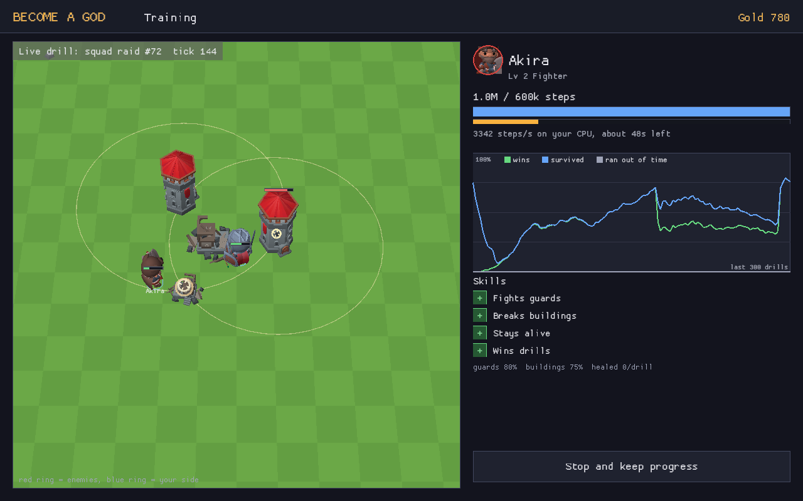

- **Frame:** Full screen, no zoom. Let the viewer see the whole training screen once.
- **Action:** The live drill plays on the left. Step counter and blue bar climb on the right.
- **Insert (last 2s):** Punch-in on **"3342 steps/s on your CPU, about 48s left"**.
- **VO:** "Then you let it practise. Thousands of times a second, on your own machine."
- **Sound:** A fast rising tick under the counter.

### Shot 10 · 0:40 to 0:47 · The wrong lesson

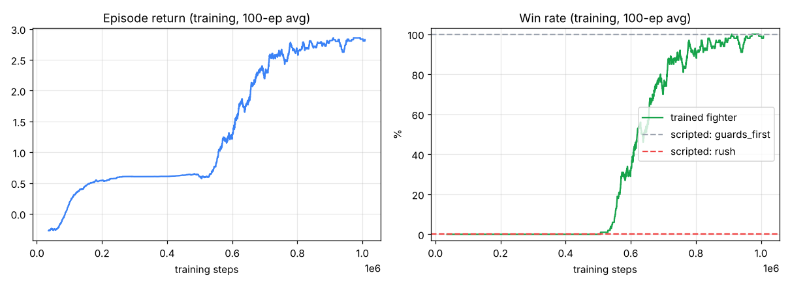

*Reference for the shape we want: the prototype's plateau, where the fighter hid until time ran out.*

- **Frame:** Split. Left half: the live drill, troop standing outside the tower ring. Right half: punch-in on the chart, the green "wins" line flat at zero.
- **Action:** Nothing happens. That's the point. Hold on it.
- **VO:** "For a while it learns the wrong thing. That hiding is safer than winning."
- **Sound:** Strings hold one long chord.
- **Capture:** Record a fresh troop's chart from 0 steps (the `train.png` chart already has data). Pick a run whose wins line stays flat for a while before it rises. If no run shows it clearly, animate the prototype curve in the game's chart style instead, and note in the end slate that it's the prototype.

### Shot 11 · 0:47 to 0:51 · It gets it

- **Frame:** The chart alone, full width.
- **Action:** The green line breaks upward and keeps climbing.
- **VO:** "And then, one day..."
- **Sound:** The chord resolves on the jump.

### Shot 12 · 0:51 to 0:56 · Skills

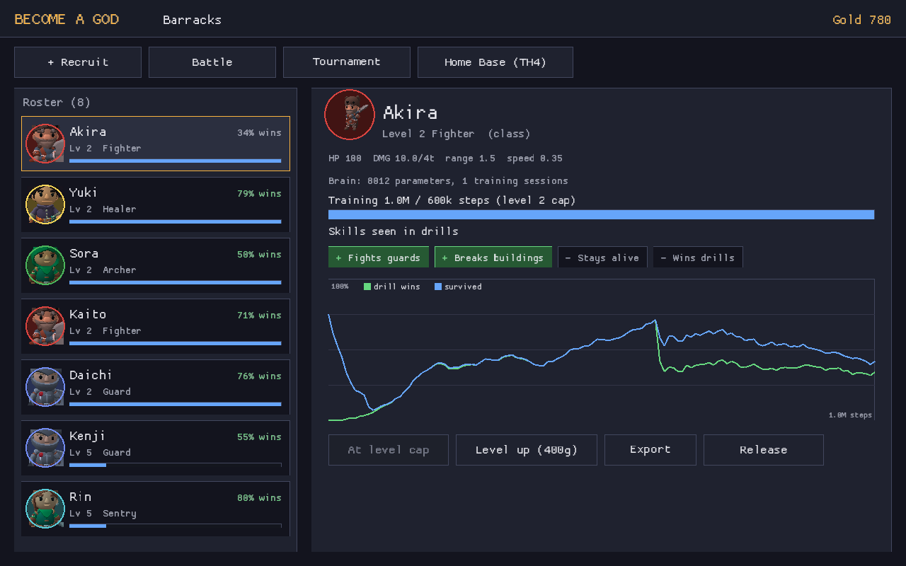

- **Frame:** Punch-in on the Skills list in the training screen (`train.png`, right column).
- **Action:** The four badges turn green one after another: Fights guards, Breaks buildings, Stays alive, Wins drills. About 0.8s apart.
- **VO:** "...it gets it."
- **Sound:** One chime per badge, rising in pitch.
- **Capture:** The badges light up live during training. If they all light too fast, speed-ramp a longer take or rebuild the beat in the edit from four frames.

---

## ACT IV: THE WAR

### Shot 13 · 0:56 to 1:00 · Pick the squad

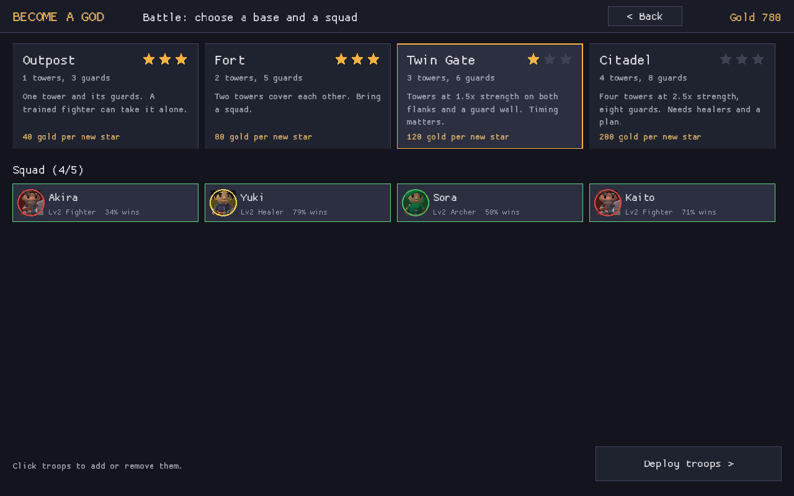

- **Frame:** Quick cuts, about 1s each: the Fort card is selected, four or five troops are clicked into the squad, the cursor drops troops on the map outside the red zone.
- **VO:** (silence, music only)
- **Capture:** `tools/tours/attack.txt`.

### Shot 14 · 1:00 to 1:07 · FIGHT!

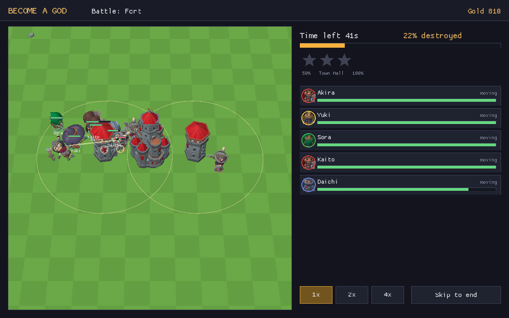

- **Frame:** Open on a tight punch-in on the **FIGHT!** button, then hard cut to the full battle screen as the click lands.
- **Action:** The squad (Akira, Yuki, Sora, Kaito, Daichi) moves in. Fighters take the guards, the healer stays behind them, then everyone turns on the tower.
- **VO:** "You don't control them in battle. You already did your part."
- **Sound:** Drums and choir in on the click. Clashes.
- **Camera:** Slow push toward the castle.

### Shot 15 · 1:07 to 1:11 · Stars

- **Frame:** Two quick inserts: the red castle collapsing into rubble, then the stars panel (50%, Town Hall) filling.
- **Sound:** Collapse rumble, then a "ding" per star.
- **Capture:** Same tour, later in the battle. Use 2x speed if the collapse comes late, then show it at 1x.

### Shot 16 · 1:11 to 1:16 · The other side

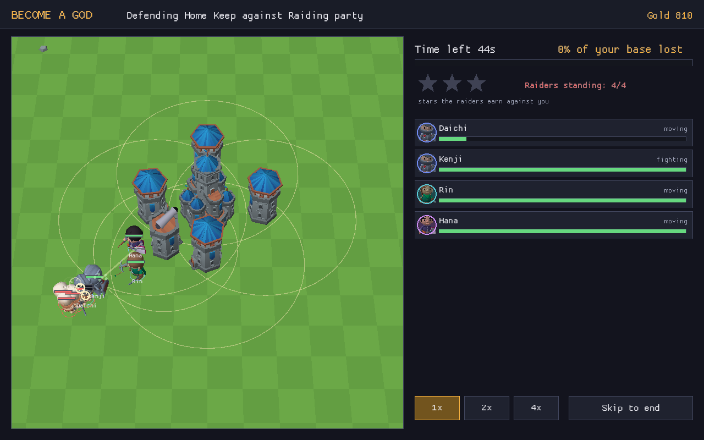

- **Frame:** Full screen. Blue towers. The title bar reads "Defending Home Keep against Raiding party".
- **Action:** Skeleton raiders come in from the lower left. Defenders step out to meet them, then fall back under the towers.
- **VO:** "Your defenders learned too. The same way."
- **Insert (last 1s):** Punch-in on **"0% of your base lost"**.
- **Capture:** `tools/tours/defence.txt`.

### Shot 17 · 1:16 to 1:20 · Champion

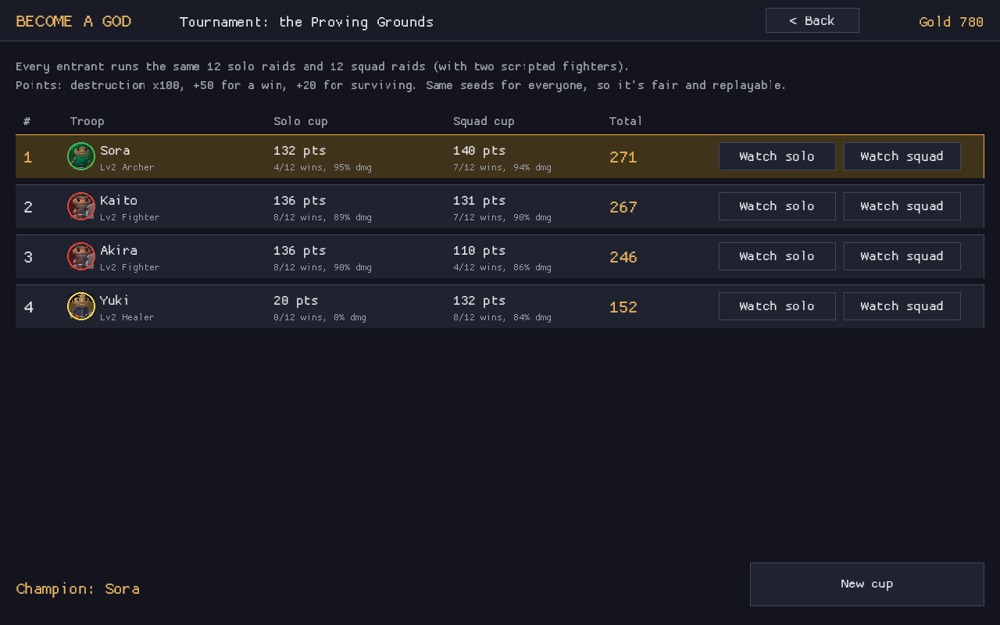

- **Frame:** Start on the full table, then punch in on the gold top row (Sora, 271), then cut to **"Champion: Sora"** in the lower left.
- **VO:** "Same mix, same plan, two different soldiers. No two of yours will fight the same way."
- **Sound:** Crowd roar on "Champion".
- **Capture:** `tools/tours/tournament.txt`.

---

## ACT V: THE PANTHEON

### Shot 18a · 1:20 to 1:26 · The gallery

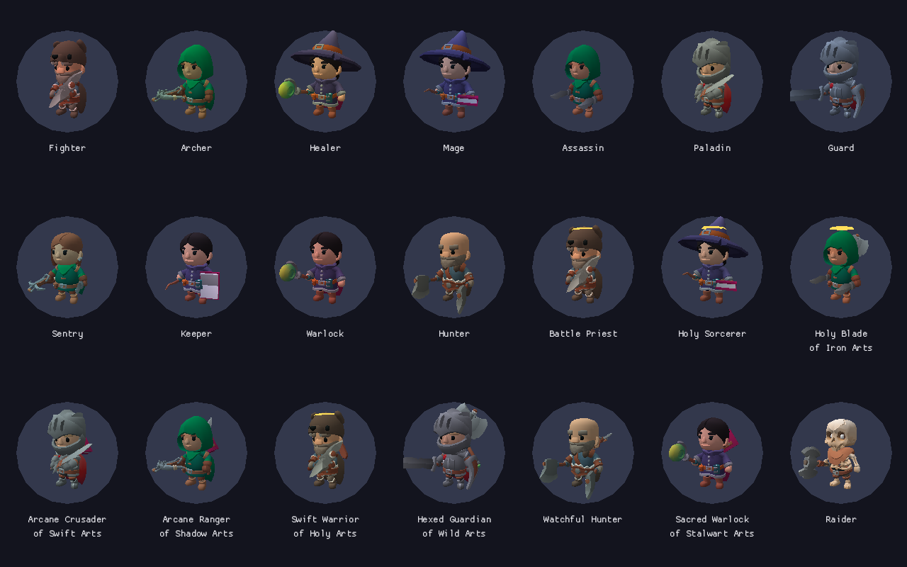

- **Frame:** Start tight on the top-left portrait (Fighter). Slow pan right across the base classes, then down across the blends: Battle Priest, Holy Sorcerer, Arcane Crusader of Swift Arts, Hexed Guardian of Wild Arts. End on the lone skeleton Raider in the bottom-right corner.
- **VO:** "You didn't make soldiers." [beat] "You made minds."
- **Sound:** Choir swells.
- **Capture:** `gallery.png` is a still; render it at 2x or 4x for a clean pan.

### Shot 18b · 1:26 to 1:30 · Title card

```
+------------------------------------------------+
|                                                |
|                  BECOME A GOD                  |
|                                                |
|          TRAIN THEM. TRUST THEM. RULE.         |
|                                                |
|                                                |
|      Every troop learns on your own computer.  |
+------------------------------------------------+
```

- **Frame:** Smash cut from the gallery. Gold title on #16161e, the same font and colour as the game's top-left logo.
- **Action:** "BECOME A GOD" appears on the music cut. The three-word line appears one word group per hit. The small line fades in last.
- **Sound:** Three hits, then silence.
- **Out:** Fade to black over 1s.

---

## Capture checklist

| Clip | How | Save state |
|---|---|---|
| Untrained Fighter (shots 1 to 3) | Fresh save, recruit Fighter, +50k, record first drills | empty `BAG_SAVE_DIR` |
| Recruit and plan (5 to 8) | `tools/record.sh tools/tours/training.txt videos/t_recruit.mp4` | the 8-troop TH4 save used for the README clips |
| Chart from zero (10, 11) | New troop, record the whole training session, find the plateau | fresh save |
| Skills lighting (12) | Same take as above | fresh save |
| Attack on the Fort (13 to 15) | `tools/record.sh tools/tours/attack.txt videos/t_attack.mp4` | 8-troop TH4 save |
| Defence (16) | `tools/record.sh tools/tours/defence.txt videos/t_defence.mp4` | 8-troop TH4 save |
| Tournament (17) | `tools/record.sh tools/tours/tournament.txt videos/t_cup.mp4` | 8-troop TH4 save |
| Gallery (18a) | Re-render the gallery at higher resolution | n/a |

Recordings go in `game/videos/`, which git ignores, as the README says. Only this storyboard and the script live in the repo.
